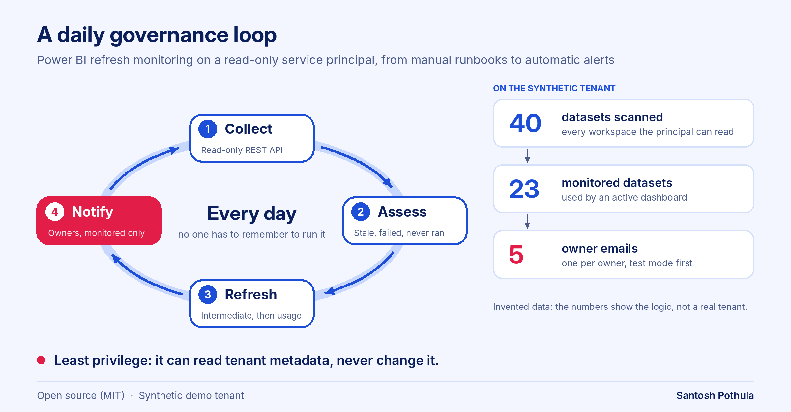

# Power BI Governance Automation

How to turn manual Power BI audit runbooks into a **daily, alerting governance loop**: collect refresh facts with a read-only service principal, assess them with tested rules, refresh the monitoring models in order, and email only the owners of datasets that matter.

> **Clean-room demo.** This repo contains the rules and the design as tested code running on a **synthetic tenant** (invented workspaces, datasets and `example.com` owners). No employer or client data, tenant details, workspace names or real reports are included.



## The problem

Refresh failures and abandoned datasets are found when a stakeholder complains. Manual scripts help, but they depend on a person to run them, produce files that someone copies into a model, and never tell the dataset owner anything.

## What the daily loop does

1. **Collect** dataset, owner and refresh-history facts through the Power BI REST API using a read-only service principal.
2. **Assess** each dataset with explicit rules and write `DailyRefreshStatus.csv` for the monitoring model.
3. **Refresh** the intermediate model, then the usage model, in dependency order, with failure emails.
4. **Notify** owners whose *monitored* datasets are stale, failed or never refreshed, one email per owner, rehearsed in test mode first.

The architecture and the reasoning behind each decision are in [docs/architecture.md](docs/architecture.md).

## The rules (tested)

| State | Meaning |
|---|---|
| **Healthy** | scheduled, refreshed within the threshold |
| **Stale** | scheduled, older than 1 day plus a 2-hour grace (so schedule jitter does not flap) |
| **Failed** | the last refresh attempt failed |
| **Never refreshed** | scheduled, no history |
| **Not scheduled** | no schedule, so never "stale" |
| **Archive candidate** | no refresh for 6+ months. A review flag only; the pipeline archives nothing |

Alert design: only datasets used by an active dashboard trigger owner emails, one email per owner, unknown owners route to a governance mailbox, and **test mode** sends everything to one recipient with a `[TEST - intended for ...]` prefix.

## Try it

Python 3.9+, standard library only.

```bash
python run.py                                  # evaluate the synthetic tenant, test mode
python run.py --mode live --extra-recipient team@example.com
python -m unittest discover -s tests           # 30 tests
```

Output goes to `output/`: `DailyRefreshStatus.csv` (fixed name, what a downstream model reads), a dated copy, and `outbox/` with one text file per email instead of sending anything.

### Result on the synthetic tenant

40 datasets, evaluated at a fixed time:

| State | Datasets |
|---|---|
| Healthy | 22 |
| Stale | 8 (3 of them months old) |
| Failed | 3 |
| Never refreshed | 1 |
| Not scheduled | 6 |
| Archive candidates | 5 |

Of the 40, 23 are marked as monitored, which produces 5 owner emails (one per owner), instead of one email for every problem dataset in the tenant. These numbers come from invented data and say nothing about a real tenant.

## Power BI report

The run also writes a four-table star schema (`output/powerbi/`: `dim_dataset`, `fact_daily_status`,
`fact_refresh_attempt`, `dim_date`) with 30 days of daily snapshots, produced by the same rules as
the live status. `powerbi/` holds the Power Query, DAX measures, theme and page spec to build the
report in Desktop, plus expected values to check it against. No `.pbix` is included and the kit has
not been opened in Desktop yet. See [powerbi/README.md](powerbi/README.md).

## Project layout

```
src/govmon/status.py    the rules
src/govmon/notify.py    owner emails, test/live mode, outbox
src/govmon/outputs.py   fixed-name status file plus dated copy
src/govmon/client.py    synthetic tenant, and a REST client sketch
sample_data/            the monitored-datasets list
tests/                  30 unit tests
docs/                   architecture and diagram
```

## Limitations

- **The REST client is an untested sketch.** `RestClient` shows the shape of the calls but needs a real tenant, and endpoints, scopes and permissions must be verified against Microsoft's documentation. Everything else is exercised against the synthetic client.
- **No actual email sending.** Messages are built and written to files. A real deployment hands them to a mail connector.
- **The Fabric pipeline, notebook scheduling, semantic models and report subscriptions are described, not included.** They live in the platform, not in code here.
- **Thresholds are demo defaults.** Choose your own stale window, grace period and archive age.
- Refresh facts only. Row-level security audits, group expansion and usage metrics are covered as design notes, not code.

## License

MIT, see `LICENSE`. Author: Santosh Pothula
